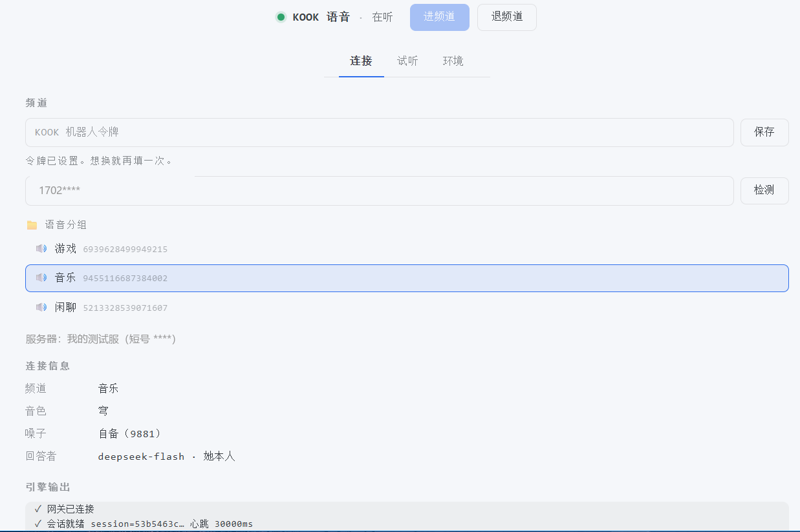
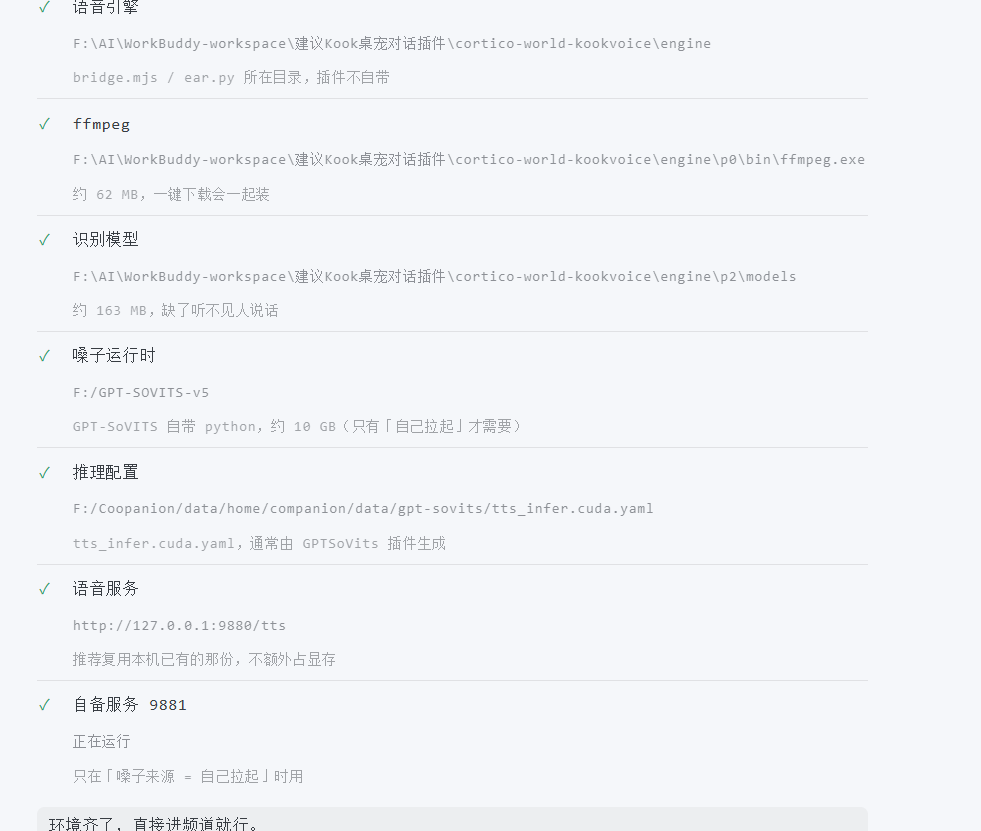

# KOOK 语音世界

让 Coopanion 的桌宠进 KOOK 语音频道：**听得见你说话、用她自己的声音回答、记得住聊过的事**。

不是另一个人格 —— KOOK 里的话会投进她的主循环，她用同一套人设、记忆和上下文回应，
所以语音里聊的东西她之后在文字对话里也记得。



<details>
<summary>环境检查长什么样</summary>



</details>

---

## 她需要什么

| 能力 | 靠什么 |
|---|---|
| 听 | SenseVoice（本地识别）+ Silero VAD（判断说完了没） |
| 想说就登记记忆 | Coopanion 主循环（她本人），工具 `kook_speak` 让她开口 |
| 出声 | GPT-SoVITS —— **不在本插件内**，需另装 Coopanion 的「GPTSoVits 语音」扩展 |

---

## 安装

### 1. 装本插件

在 Coopanion 里装好本世界后，去「World 扩展 → KOOK 语音」。

### 2. 填 KOOK 机器人令牌

**还没有机器人？** → **[从零创建一个（约 5 分钟）](docs/KOOK-SETUP.md)**

打开面板 → 「频道」页 → 最上面那个 **令牌框** → 粘贴 → 点「保存」。

> 令牌在 KOOK 开发者后台 → 你的应用 → 机器人 → Token。

保存后会存在配置里（存不了就写 `engine/p0/token.txt`）。
也可以直接设环境变量 `KOOK_TOKEN`，效果一样。

### 3. 点「下载依赖」

打开面板 → 「环境」页 → 点 **「下载依赖（约 225 MB）」**。

会下三样东西到 Coopanion 的用户数据目录（**不在插件包里**，重装插件不会丢）：

| 组件 | 大小 | 说明 |
|---|---|---|
| ffmpeg | 62 MB | 推流和音频解码 |
| SenseVoice | 163 MB | 中文语音识别模型 |
| Silero VAD | 629 KB | 断句 |

下载有进度，**中断了再点一次会接着下**（已完成的跳过）。

### 4. 让嗓子能用

去装 Coopanion 的「GPTSoVits 语音」扩展，它会自己下载运行时和权重（约 10 GB）。

装好之后回到本插件，「环境」页应看到「语音服务」是绿的。

### 5. 进频道

面板「频道」页 → 输入服务器 ID（或 8 位短号、或服务器名字）→ 点「检测」→ 选一个语音频道 → 点「进频道」。

**不会自动进频道**，每次都要手动点 —— 这是有意的。

---

## 第一次用要注意

**唤醒词**：默认「说什么都接」。多人频道里建议改成「叫名字才接」，并在这里填她的简称 ——
比如她叫「春日野穹」，就填 `穹`（不填的话喊「穹」不会触发，因为匹配的是完整名字）。

**延迟**：从你说完到她开口大约 **4~7 秒**（主循环要读人设、查记忆、想一遍）。这是「她真的是她」的代价，
换更快的模型就不那么像她了。

**掉线**：网络抖动会让她掉出频道。程序会自动重连（`✓ 已重连`），不用手动退进。

---

## 结构

```
src/            插件逻辑（世界定义、状态机、面板后端）
webui/          面板前端
engine/p0/      KOOK API 客户端
engine/p1/      语音推流（RTP + ffmpeg）、主流程编排
engine/p2/      音频采集 + VAD + 识别调度、依赖下载器
docs/           环境清单（模型地址、校验值）
```

引擎代码随插件分发；**ffmpeg 和模型由「下载依赖」按需获取**。

---

## 许可

本插件代码 **MIT**。

第三方组件（ffmpeg 是 **GPL v3**、SenseVoice/VAD 是 MIT、sherpa-onnx 是 Apache-2.0）详见
[THIRD-PARTY.md](THIRD-PARTY.md)。

> KOOK 的语音推流协议未公开，本项目通过协议分析实现。使用前请自行确认符合 KOOK 服务条款。
